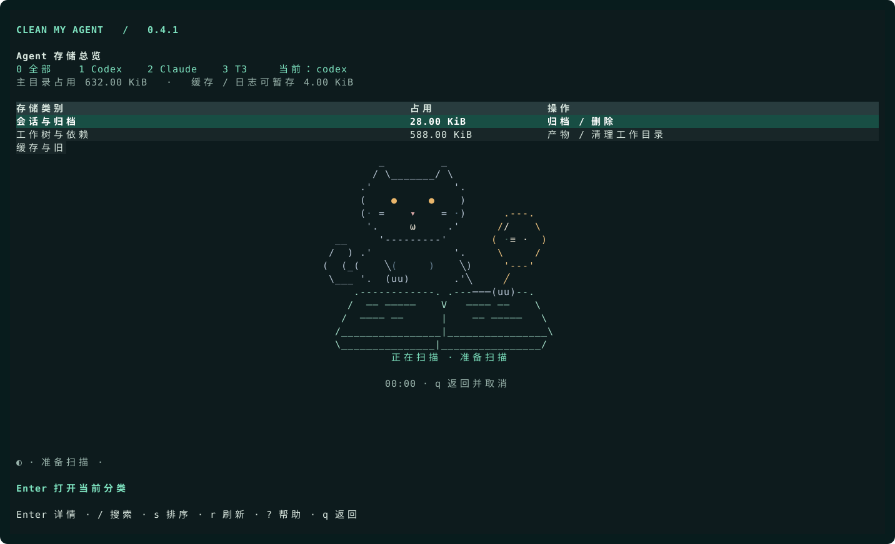
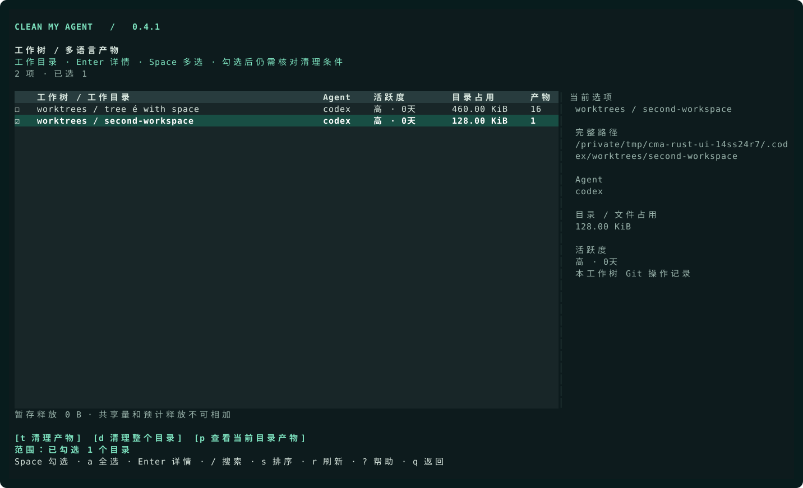
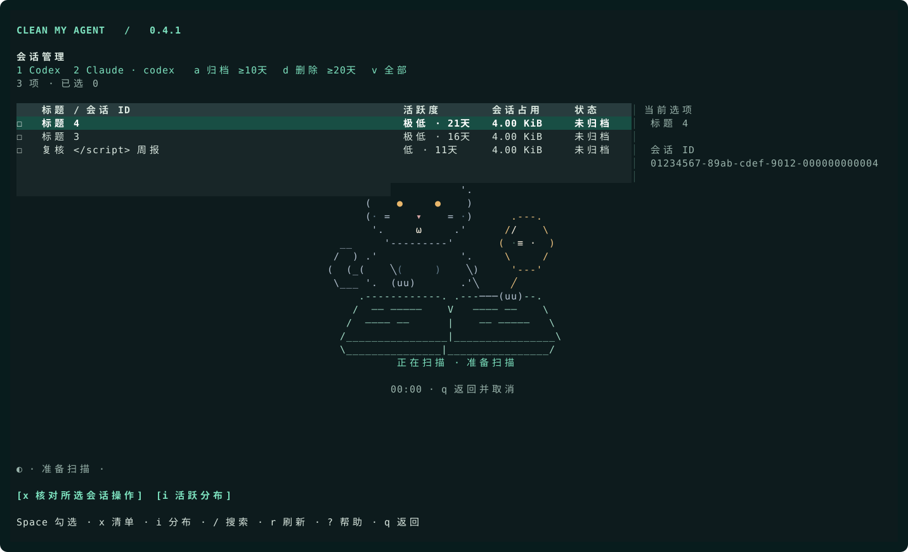

<p align="center">
  <a href="assets/logo.png"></a>
</p>

<h1 align="center">Clean my Agent</h1>

<p align="center"><strong>See where your coding agents' disk space goes. Review, stage, then clean.</strong></p>

<p align="center"><b>English</b> · <a href="README_CN.md">简体中文</a></p>

<p align="center">
  <a href="https://github.com/fisecoco-byte/clean-my-agent/releases/latest">Download</a> ·
  <a href="#quick-start">Quick start</a> ·
  <a href="#ai-agents-mcp-and-skill">AI / MCP</a> ·
  <a href="#documentation">Documentation</a>
</p>

Inspect **Codex, Claude Code and T3** storage from one terminal dashboard. Find large worktrees, review inactive sessions, and clean eligible caches, old logs and rebuildable project artifacts. Known caches and old versions of other agents are available in the resource inventory.

**v0.4.1 is the native Rust release:** the CLI, scanner, terminal interface and MCP run in one executable. [Release notes](docs/releases/v0.4.1.md).

## Features

- **One storage dashboard.** Browse agents, sessions, worktrees, dependencies, caches, extensions and the quarantine area.
- **Separate size from savings.** See directory size, shared storage and estimated space reclaimable by deleting one directory. Cross-worktree references are marked and protected.
- **More than `node_modules`.** Inspect Python environments, Rust and JVM build output, .NET artifacts, web framework caches and other supported project directories.
- **Review inactive work.** Sort worktrees, project directories and sessions by activity; see session IDs, titles and the evidence behind activity estimates.
- **Stage before removing files.** Review a selection, move eligible items into recoverable quarantine, then restore or explicitly delete them.
- **Built for agents too.** JSON reports, a local MCP server and a reusable Skill; MCP is read-only by default.



[Current Rust screenshots and regeneration](docs/rust-screenshots.md). All screenshots use isolated fictional data.

The terminal interface and detailed guides are currently in Chinese. This README provides the English installation and usage instructions.

## Quick start

Release packages contain a native Rust executable, terminal UI and MCP server. No Python, Node.js, Homebrew or administrator access is needed to install.

**macOS / Linux / Ubuntu**

```sh
curl -fsSL https://raw.githubusercontent.com/fisecoco-byte/clean-my-agent/main/install.sh | bash
```

**Windows PowerShell**

```powershell
irm https://raw.githubusercontent.com/fisecoco-byte/clean-my-agent/main/install.ps1 | iex
```

The installer selects the architecture, verifies the download and adds the command to your **user PATH**. Reopen your terminal after the first installation, then run from any directory:

```sh
clean-my-agent
```

Run the same installation command to update. Alternatively, download and extract a package from [GitHub Releases](https://github.com/fisecoco-byte/clean-my-agent/releases/latest), then run its bundled installer.

| Platform | Packages | Availability |
| --- | --- | --- |
| macOS | Apple Silicon / Intel | Inventory and cleanup; builds validated on macOS 15 |
| Linux / Ubuntu | ARM64 / x64 | Inventory and cleanup; glibc 2.35+, such as Ubuntu 22.04+ |
| Windows | x64 | **Read-only inventory and MCP**; no staging, restore, deletion or session changes |

Alpine / musl and native Windows ARM64 packages are not currently provided. On macOS / Linux, dependency cleanup also requires Git and `lsof`; incomplete checks keep items protected. See the [installation guide (中文)](docs/installation.md) for requirements, custom paths and uninstallation.

This README follows `main`; the installer downloads the latest **published Release**. See the release notes for the features included in that version.

## Common commands

```sh
clean-my-agent                       # Interactive storage dashboard
clean-my-agent --agent codex         # Codex only
clean-my-agent dashboard --quick     # Skip expensive measurements; show omissions
clean-my-agent deps                  # Worktrees and multi-language project artifacts
clean-my-agent reporter              # Session IDs, titles, activity and review actions
clean-my-agent resources             # Agent caches, old versions and leftovers
clean-my-agent extensions            # Skill / MCP / Plugin versions; read-only
clean-my-agent clean --details       # Preview eligible caches and old logs
clean-my-agent trash                 # List quarantine batches
clean-my-agent --version             # Verify the installed version
clean-my-agent --build-info          # Version, platform, commit and source digest
clean-my-agent --help
```

For scripts and AI clients:

```sh
clean-my-agent dashboard --json      # Agent home-directory overview
clean-my-agent scan --json           # Full report, including artifact measurements
clean-my-agent deps --json           # Shared storage, references and reclaim estimates
```

Use `--plain` for plain text. JSON output and non-interactive terminals do not wait for key presses. `dashboard`, `home` and interactive `scan` also open the dashboard.

## Use the dashboard

Press `0 / 1 / 2 / 3` to filter All / Codex / Claude / T3. Use `↑ / ↓` to choose a category and `Enter` to open it. `q` returns from a child page or exits the dashboard; `?` opens help.

| Page | Actions |
| --- | --- |
| Sessions & archives | Review ID, title and activity. `a` selects archive review, `d` delete review; `Space` selects sessions and `x` opens the action list. |
| Worktrees & directories | `Space` selects directories; `a / Ctrl+A` toggles all filtered rows. `t` opens artifacts for the selected directories; `d` reviews one entire directory. `p` shows artifacts for the cursor row; `w` switches between directories and all artifacts. |
| Project artifacts | `Space` selects candidates; `a / Ctrl+A` toggles all filtered candidates, including off-screen rows. `t` reviews staging; `v` opens quarantine. |
| Caches & old logs | `Space` selects files; `t` reviews and stages them. |
| Agent versions & desktop resources | Inspect caches, old versions and update leftovers; `t` reviews eligible candidates. |
| Skill / MCP / Plugin | Inspect versions, references and native cleanup guidance; **read-only**. |
| Quarantine | Select entries with `Space`; `r` requires `RESTORE`, `d` requires `DELETE`, then `Enter` confirms. |

Review the full list before confirming. `Esc` cancels a confirmation dialog. Unselected quarantine entries remain untouched.

### Clean selected work directories

1. Select one or more directories with `Space`; selection stays when you move the cursor or sort.
2. Press `t` to view their artifact cleanup list. Select eligible artifacts with `Space`, then press `t`, type `STAGE` and confirm with `Enter`.
3. Open quarantine with `v` to restore or permanently delete staged entries.

To review removal of an **entire directory**, select exactly one directory and press `d`. Selecting a directory sets the scope; the review can still retain it and explain why. With no checked rows, `t` and `d` use the cursor row.



[Artifact view](docs/rust-deps.svg)

### Read storage numbers correctly

| Metric | Meaning |
| --- | --- |
| Directory size | Allocated storage attributed to that directory, including shared blocks. |
| Shared storage | Blocks also referenced elsewhere; incomplete measurements may be shown as unknown or bounded estimates. |
| Estimated reclaimable | Space estimated to become reclaimable if this directory alone were permanently removed at measurement time. |

**Directory size is not reclaimable space. Do not add the per-row reclaim estimates together.** Shared blocks, open files, snapshots and filesystem support affect what can actually be reclaimed. Windows reports allocation where available; unsupported shared/reclaimable measurements remain unknown. A retained item's size estimate does not make it eligible for cleanup.

### Activity and scanning

| Activity | Time since last observed activity |
| --- | --- |
| High | Less than 5 days |
| Medium | 5–9 days |
| Low | 10–14 days |
| Very low | 15 days or more |
| Unknown | Missing or incomplete evidence |

Press `s` to switch sorting and `Enter` to inspect the evidence. Worktrees and sessions start with the least recently active items; artifacts start with estimated reclaimable space. Selection is preserved when sorting. Activity is an estimate, not permission to delete.

Scanning shows a cat animation, elapsed time and real progress when a count is known. Small windows use a one-line animation. The worktree/artifact view lists discovered directories first, then fills in measurements and checks; cleanup becomes available after measurement completes. Opening a page starts a scan; `r` rescans and file operations refresh the results. An empty result is shown only after scanning completes; failures show an error.

<details>
<summary>Session selection and inactivity thresholds</summary>



Archive and deletion review thresholds can each be set to **5, 10, 15 or 20 days**. They produce review lists; they do not schedule automatic actions.

```sh
clean-my-agent reporter --agent codex --archive-days 10 --delete-days 20
```

Confirmed Codex session actions use native Codex commands. Claude sessions remain read-only. Execution rechecks session activity and protection rules, then reports individual results.

</details>

## Cleanup boundaries

**Staging moves files out of their original location and frees 0 B.** After `STAGE`, files are moved on the same filesystem into `${XDG_STATE_HOME:-~/.local/state}/clean-my-agent/<batch>`. This is a recoverable holding area, with no compression and no automatic expiry. A staged dependency or build directory is unavailable to the project until restored or rebuilt.

In Quarantine, select entries: `r` + `RESTORE` moves them back; existing files at the destination are never overwritten, and conflicting entries stay in quarantine. `d` + `DELETE` permanently removes the selected entries after fresh checks. Unselected entries remain. Archiving sessions and moving directories to the system Trash also do not immediately free space.

- Caches, old logs and rebuildable artifacts are checked against policy before staging and rechecked before changes.
- Dependency checks cover project type, Git protection, worktree references and running processes. Node dependencies also have installation-record and post-install modification checks.
- Old-version cleanup retains the active version and one fallback version. Busy resources and resources whose status cannot be established are kept.
- **Entire-directory cleanup is separate from artifact staging.** Linked Git worktrees use native Git removal with `DELETE`. Eligible standalone repositories on macOS can move to the system Trash with `TRASH`. Reviews check uncommitted changes, unpushed commits, running processes, references and ignored files; retained entries show the reason.
- Skill / MCP / Plugin version inventory remains read-only. It provides references and native cleanup guidance rather than uninstalling extensions.
- Windows does not enable write operations. The default MCP server does not expose permanent deletion or session changes.

The [Mole comparison (中文)](docs/mole-reference.md) documents 34 project-directory patterns from a pinned upstream revision and the agent-resource rules implemented here. Names alone never make a directory a cleanup candidate.

## AI agents: MCP and Skill

After installing the release package, register the **read-only** local MCP server with your client:

```sh
# Codex
codex mcp add clean-my-agent -- clean-my-agent mcp

# Claude Code
claude mcp add --scope user clean-my-agent -- clean-my-agent mcp
```

Or ask an agent **running on this computer**:

> Follow https://github.com/fisecoco-byte/clean-my-agent to install the release package for this system and register the read-only clean-my-agent MCP server. Preserve existing client configuration. Verify the connection by calling get_policy, then report Codex and Claude Code storage separately. Do not stage or delete any files.

Release archives include `skills/clean-my-agent`. Copy that folder into `~/.agents/skills/` for Codex, or `${CLAUDE_CONFIG_DIR:-~/.claude}/skills/` for Claude Code, preserving any existing same-name Skill. Reopen the client and invoke `$clean-my-agent` in Codex or `/clean-my-agent` in Claude Code.

MCP provides inventory and previews by default. Optional `--allow-stage` enables staging and restoration on macOS / Linux; it does **not** enable permanent deletion, compression or session changes. See the [agent setup guide (中文)](docs/agent-setup.md) for available tools and configuration.

## Documentation

Detailed guides are currently in Chinese; both READMEs cover the same core workflows.

| Guide | Contents |
| --- | --- |
| [中文 README](README_CN.md) | Chinese installation and usage instructions |
| [Installation](docs/installation.md) | Packages, PATH, update, uninstall and release process |
| [Illustrated user guide](docs/user-guide.md) | Screenshots, key bindings, policies and troubleshooting |
| [Worktrees](docs/worktrees.md) | Artifact staging and native whole-worktree removal |
| [Resources and versions](docs/resources-and-versions.md) | Installation checks, runtime checks and old-version retention |
| [Agent setup](docs/agent-setup.md) | MCP, Skill, tool permissions and client configuration |
| [Mole comparison](docs/mole-reference.md) | Pinned upstream rules and implementation boundaries |
| [Scan performance](docs/scan-performance.md) | Measurement behavior and reproducible benchmarks |
| [Rust migration](docs/rust-migration.md) | Compatibility checks and migration validation |
| [v0.4.1 release notes](docs/releases/v0.4.1.md) | Native runtime and workspace cleanup changes |

<details>
<summary>Develop from source</summary>

Release users do not need these steps. For development:

```sh
git clone https://github.com/fisecoco-byte/clean-my-agent.git
cd clean-my-agent
cargo build --release --locked
cargo test --locked
./clean-my-agent
```

Use the same Cargo commands on Windows, then run `target\release\clean-my-agent.exe`. Windows remains read-only.

Source builds require the Rust toolchain. The Python source is retained for compatibility comparisons; it is not the release runtime. Packaging helpers require Python 3.11+. For MCP and Skill setup on macOS / Linux, use `./scripts/install-agent.sh codex` or `./scripts/install-agent.sh claude`. The server runs the native executable from this checkout; Python is not required at runtime.

</details>

## Acknowledgments

[Mole](https://github.com/tw93/mole) inspired the terminal workflow, installation approach and README structure. [Ratatui](https://ratatui.rs/) and [Crossterm](https://github.com/crossterm-rs/crossterm) power the interface; [ascii.rest](https://ascii.rest/) supplies the character-art drawing tools used by the offline loading animation. The pixel cat is Clean my Agent's mascot. [Transparent logo](assets/logo.png).
