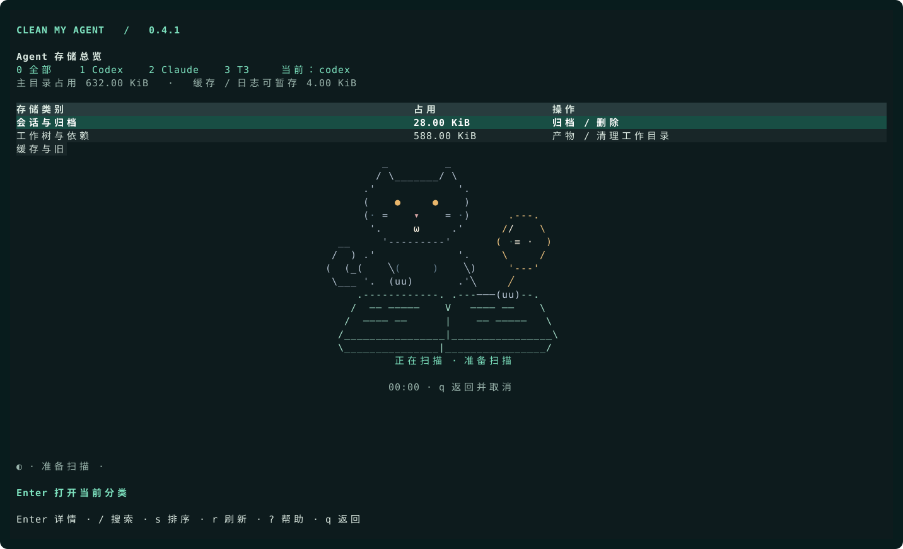
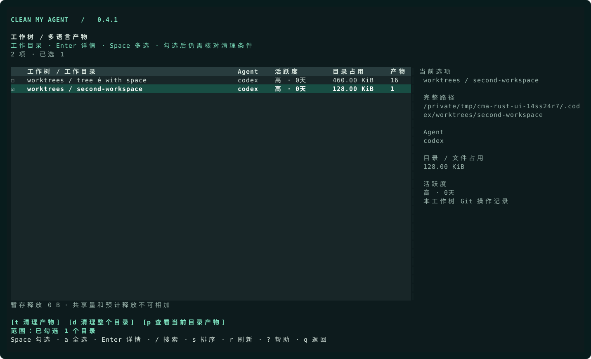
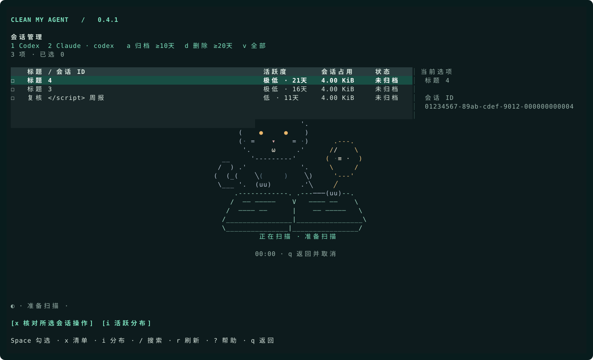

<p align="center">
  <a href="assets/logo.png"></a>
</p>

<h1 align="center">Clean my Agent</h1>

<p align="center"><strong>看清 AI 编程工具的存储占用，先核对、再暂存、按需清理。</strong></p>

<p align="center"><a href="README.md">English</a> · <b>简体中文</b></p>

<p align="center">
  <a href="https://github.com/fisecoco-byte/clean-my-agent/releases/latest">下载安装</a> ·
  <a href="#快速开始">快速开始</a> ·
  <a href="#ai-接入mcp-与-skill">AI / MCP</a> ·
  <a href="#文档">使用文档</a>
</p>

在一个终端面板里查看 **Codex、Claude Code、T3** 的存储占用，找出大工作树、复核不活跃会话，清理符合策略的缓存、旧日志和可重建项目产物。其他 Agent 的已知缓存和旧版本可在资源盘点中查看。

**v0.4.2 为 Rust 原生版**：命令行、扫描、终端界面和 MCP 均由同一个原生程序运行。本版把完整依赖报告从约 459 秒降到约 83–100 秒。[查看发布说明](docs/releases/v0.4.2.md)。

## 功能

- **统一存储总览**：按 Agent 查看会话、工作树、依赖、缓存、扩展及暂存区。
- **区分占用与释放量**：目录大小、共享占用、单独删除预计释放分开展示；被其他工作树引用的目录标记并保留。
- **不止 `node_modules`**：支持 Python 环境、Rust / JVM 构建输出、.NET 产物、Web 框架缓存等项目目录。
- **复核不活跃项目**：工作树、工作目录和会话可按活跃度排序，展示会话 ID、标题及活动判断依据。
- **先暂存，再清除**：核对选中清单，将候选移入可恢复的暂存区，再决定恢复或永久删除。
- **供 Agent 调用**：提供 JSON 报告、本地 MCP 与 Skill；MCP 默认只读。



[Rust 界面截图与重新生成方式](docs/rust-screenshots.md)。截图均使用隔离的示例数据。

终端界面与详细手册目前使用中文；英文 README 提供对应的安装和使用说明。

## 快速开始

发布包包含 Rust 原生程序、终端界面和 MCP。安装不需要 Python、Node.js、Homebrew 或管理员权限。

**macOS / Linux / Ubuntu**

```sh
curl -fsSL https://raw.githubusercontent.com/fisecoco-byte/clean-my-agent/main/install.sh | bash
```

**Windows PowerShell**

```powershell
irm https://raw.githubusercontent.com/fisecoco-byte/clean-my-agent/main/install.ps1 | iex
```

安装器自动识别架构、校验下载，并注册当前用户的 **PATH**。首次安装后重新打开终端，在任意目录运行：

```sh
clean-my-agent
```

再次运行同一条安装命令即可更新。也可以从 [GitHub Releases](https://github.com/fisecoco-byte/clean-my-agent/releases/latest) 下载压缩包，解压后运行包内安装脚本。

| 平台 | 安装包 | 功能范围 |
| --- | --- | --- |
| macOS | Apple Silicon / Intel | 盘点与清理；构建验证环境为 macOS 15 |
| Linux / Ubuntu | ARM64 / x64 | 盘点与清理；需要 glibc 2.35+，如 Ubuntu 22.04+ |
| Windows | x64 | **只读盘点与 MCP**；不执行暂存、恢复、删除或会话变更 |

暂不提供 Alpine / musl 和原生 Windows ARM64 包。macOS / Linux 的依赖清理还需要 Git 与 `lsof`，无法完成检查时保留项目。系统要求、自定义路径和卸载方式见[安装指南](docs/installation.md)。

本 README 随 `main` 更新；安装器下载最新的**正式 Release**。该版本包含哪些功能，以对应发布说明为准。

## 常用命令

```sh
clean-my-agent                       # 交互式存储总览
clean-my-agent --agent codex         # 只看 Codex
clean-my-agent dashboard --quick     # 跳过耗时测量，明确显示统计缺口
clean-my-agent deps                  # 工作树与多语言项目产物
clean-my-agent reporter              # 会话 ID、标题、活跃度及操作复核
clean-my-agent resources             # Agent 缓存、旧版本和残留
clean-my-agent extensions            # Skill / MCP / Plugin 多版本，只读
clean-my-agent clean --details       # 预览缓存与旧日志候选
clean-my-agent trash                 # 列出暂存批次
clean-my-agent --version             # 核对安装版本
clean-my-agent --build-info          # 查看版本、平台、提交和源码摘要
clean-my-agent --help
```

脚本和 AI 可读取结构化报告：

```sh
clean-my-agent dashboard --json      # Agent 主目录总览
clean-my-agent scan --json           # 包含项目产物测量的完整报告
clean-my-agent deps --json           # 共享占用、引用关系和释放估计
```

`--plain` 输出纯文本；JSON 和无交互终端不会等待按键。`dashboard`、`home` 与交互式 `scan` 也可以进入总览。

## 在面板中操作

按 `0 / 1 / 2 / 3` 选择全部 / Codex / Claude / T3，`↑ / ↓` 选择类别，`Enter` 进入。子页面按 `q` 返回，总览按 `q` 退出；`?` 查看帮助。

| 页面 | 操作 |
| --- | --- |
| 会话与归档 | 查看 ID、标题和活跃时间；`a` 选择归档复核、`d` 选择删除复核，`Space` 勾选会话，`x` 打开操作清单。 |
| 工作树与工作目录 | `Space` 勾选目录，`a / Ctrl+A` 切换全选当前筛选结果；`t` 查看所选目录的产物清单，`d` 核对整个目录；`p` 仅查看光标目录的产物，`w` 切换目录与全部产物。 |
| 项目产物 | `Space` 勾选；`a / Ctrl+A` 切换全选当前筛选结果，包含屏幕外的候选；`t` 核对暂存，`v` 进入暂存区。 |
| 缓存与旧日志 | `Space` 勾选文件，`t` 核对并暂存。 |
| 版本与桌面资源 | 查看缓存、旧版本和更新残留，`t` 核对符合策略的候选。 |
| Skill / MCP / Plugin | 查看版本、引用和原生回收建议，**只读**。 |
| 暂存区 | `Space` 勾选条目；`r` 输入 `RESTORE` 恢复，`d` 输入 `DELETE` 永久清除，最后按 `Enter` 确认。 |

确认前核对完整清单，`Esc` 取消弹窗；同批次中未勾选的暂存条目保留。

### 清理选中的工作目录

1. 在工作目录页按 `Space` 勾选一个或多个目录，移动光标和排序会保留勾选。
2. 按 `t` 打开这些目录的产物清单；勾选可清理产物，再按 `t`，输入 `STAGE` 并按 `Enter` 确认。
3. 按 `v` 进入暂存区，按需恢复或永久清除。

若要清理**整个目录**，只勾选一个目录后按 `d`。勾选仅表示操作范围，仍需通过后续检查；无法清理时会展示保留原因。没有勾选时，`t` 和 `d` 使用光标所在目录。



[查看产物界面](docs/rust-deps.svg)

### 如何理解占用数字

| 指标 | 含义 |
| --- | --- |
| 目录大小 | 归属于该目录的分配空间，包含共享块。 |
| 共享占用 | 也被其他位置引用的数据块；信息不足时显示未知或估计范围。 |
| 预计释放 | 在测量时单独永久删除这个目录，预计能回收的空间。 |

**目录大小不等于可释放量，各行的释放估计不能相加。** 共享块、打开的文件、快照和文件系统能力都会影响实际回收量。Windows 按可用接口报告分配量，尚不支持的共享量与释放量保持未知。保留项的释放估计只用于理解占用，不代表可以清理。

### 活跃度与扫描

| 活跃度 | 距上次可见活动 |
| --- | --- |
| 高 | 不足 5 天 |
| 中 | 5–9 天 |
| 低 | 10–14 天 |
| 极低 | 15 天及以上 |
| 未知 | 缺少记录或核查不完整 |

按 `s` 切换排序，`Enter` 查看依据。工作树和会话默认把最久未活动的项排在前面，产物默认按预计释放排序；排序保留勾选对象。活跃度是估算，不是删除许可。

扫描时显示小猫动画、耗时和已知数量的真实进度，小窗口使用单行动画。工作树与产物页先列出发现的目录，再补齐占用与检查结果，测量完成后才开放清理。打开总览或进入子页面时启动扫描；仅浏览后返回总览，直接恢复已完成的结果和光标位置。按 `r` 刷新、切换 Agent 或执行文件变更后，旧总览失效并重新统计。扫描完成后才显示空结果，失败时展示错误。

<details>
<summary>会话勾选与未活跃天数策略</summary>



归档、删除复核阈值可分别选择 **5 / 10 / 15 / 20 天**，只生成复核清单，不定时自动操作。

```sh
clean-my-agent reporter --agent codex --archive-days 10 --delete-days 20
```

Codex 会话确认后调用原生命令处理；Claude 会话保持只读。执行前重新核实会话活动与保护规则，执行后展示逐项结果。

</details>

## 清理边界

**暂存会把文件移出原位置，释放 0 B。** 输入 `STAGE` 确认后，文件在同一文件系统内移动到 `${XDG_STATE_HOME:-~/.local/state}/clean-my-agent/<批次>`。暂存区可恢复，不压缩，也不会到期自动删除；依赖或构建目录暂存后，项目需恢复或重新安装、构建才能继续使用。

进入暂存区并勾选条目：`r` + `RESTORE` 恢复到原路径；原位置已有新文件时不会覆盖，冲突项继续保留在暂存区。`d` + `DELETE` 会重新检查后永久清除所选条目，未选条目保留。会话归档、移入系统废纸篓同样不会立即释放空间。

- 缓存、旧日志和可重建产物先核查策略，执行前再次验证。
- 依赖检查覆盖项目类型、Git 保护、工作树引用和运行进程；Node 依赖另查安装记录及安装后修改。
- 旧版本保留活动版本和一个回退版本；运行中或无法确认状态的资源保留。
- **整目录清理与产物暂存是两条独立流程**：附加 Git 工作树通过 Git 删除，确认词为 `DELETE`；符合条件的独立仓库在 macOS 可移入系统废纸篓，确认词为 `TRASH`。检查未提交改动、未推送提交、运行状态、引用和忽略文件，保留项会说明原因。
- Skill / MCP / Plugin 多版本只读盘点，提供引用与原生回收建议，不代替用户卸载扩展。
- Windows 不开放写操作；默认 MCP 不提供永久删除或会话变更。

[Mole 对照表](docs/mole-reference.md)列出固定上游版本中的 34 类项目目录，以及本工具实现的 Agent 资源规则；不会仅凭目录名称判定为清理候选。

## AI 接入：MCP 与 Skill

安装发布包后，按客户端注册**只读**本地 MCP：

```sh
# Codex
codex mcp add clean-my-agent -- clean-my-agent mcp

# Claude Code
claude mcp add --scope user clean-my-agent -- clean-my-agent mcp
```

也可以把这段话发给**运行在本机**的 Agent：

> 按 https://github.com/fisecoco-byte/clean-my-agent 的说明安装对应系统的发布包，注册只读 clean-my-agent MCP，保留已有客户端配置。调用 get_policy 验证连接，再按 Codex、Claude Code 分别给我占用报告。不要暂存或删除任何文件。

发布压缩包包含 `skills/clean-my-agent`。将整个目录复制到 Codex 的 `~/.agents/skills/`，或 Claude Code 的 `${CLAUDE_CONFIG_DIR:-~/.claude}/skills/`，保留已有同名 Skill。重新打开客户端后，Codex 使用 `$clean-my-agent`，Claude Code 使用 `/clean-my-agent`。

MCP 默认只提供盘点与预览。可选的 `--allow-stage` 在 macOS / Linux 开放暂存与恢复，**不**开放永久删除、压缩或会话变更。工具列表和配置细节见 [Agent 接入指南](docs/agent-setup.md)。

## 文档

详细手册目前使用中文，两版 README 覆盖相同的核心流程。

| 文档 | 内容 |
| --- | --- |
| [English README](README.md) | 英文安装与使用说明 |
| [安装指南](docs/installation.md) | 安装包、PATH、更新、卸载和发布流程 |
| [图文使用手册](docs/user-guide.md) | 截图、按键、策略与常见问题 |
| [工作树操作](docs/worktrees.md) | 产物暂存与原生整树删除 |
| [资源与版本](docs/resources-and-versions.md) | 安装检查、运行检查和旧版本保留 |
| [Agent 接入](docs/agent-setup.md) | MCP、Skill、权限与客户端配置 |
| [Mole 对照表](docs/mole-reference.md) | 固定上游规则及实现边界 |
| [扫描性能](docs/scan-performance.md) | 测量方式与可复现性能对比 |
| [Rust 迁移记录](docs/rust-migration.md) | 兼容性对照与迁移验收 |
| [v0.4.2 发布说明](docs/releases/v0.4.2.md) | 扫描与复核提速 |

<details>
<summary>从源码开发</summary>

发布包用户无需执行这些步骤。参与开发时：

```sh
git clone https://github.com/fisecoco-byte/clean-my-agent.git
cd clean-my-agent
cargo build --release --locked
cargo test --locked
./clean-my-agent
```

Windows 构建命令相同，运行 `target\release\clean-my-agent.exe`；保持只读盘点。

源码构建需要 Rust 工具链。Python 源码保留用于兼容性对照，不作为发布包运行时；打包辅助脚本需要 Python 3.11+。macOS / Linux 的 MCP 与 Skill 安装可运行 `./scripts/install-agent.sh codex` 或 `./scripts/install-agent.sh claude`；启动命令为本仓库的 Rust 可执行文件，运行时不依赖 Python。

</details>

## 致谢

[Mole](https://github.com/tw93/mole) 为终端操作流程、安装方式和 README 结构提供了参考。[Ratatui](https://ratatui.rs/) 与 [Crossterm](https://github.com/crossterm-rs/crossterm) 构建 Rust 终端界面，[ascii.rest](https://ascii.rest/) 提供离线 Loading 的字符绘图能力。蓝白像素猫是 Clean my Agent 的品牌形象。[下载透明 Logo](assets/logo.png)。
