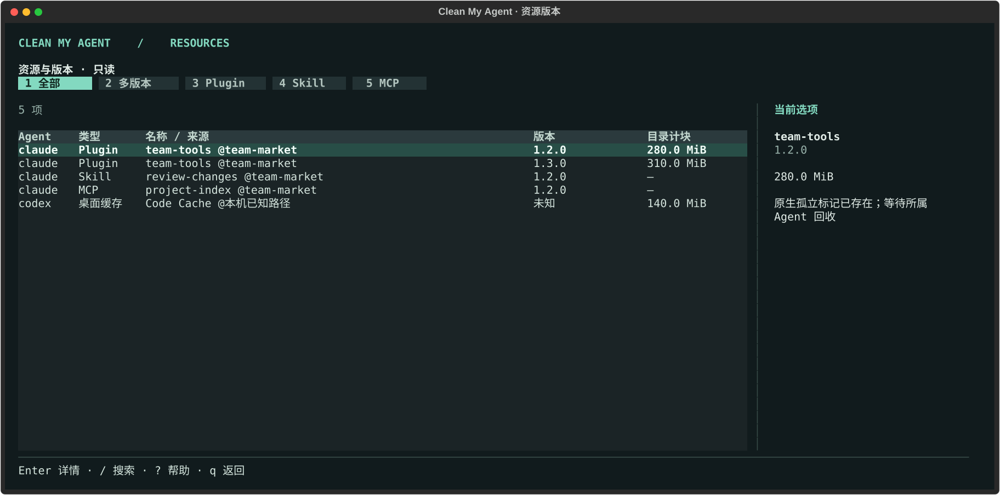

# 运行状态、额外资源与扩展版本

[返回首页](../README.md) · [完整使用手册](user-guide.md)

## deps 的新增检查

原有 Git、保留期、挂载卷和工作树引用检查继续生效。总览进入依赖页后，以及完整 `deps` / `scan --json` 报告中的每个实体依赖，都有 `installation` 和 `runtime` 两组结果，列表详情和 JSON 都能看到。

| 检查 | 可继续核对的条件 | 保留情况 |
| --- | --- | --- |
| 安装记录 | npm 的 `.package-lock.json`、pnpm 的 `.modules.yaml`，或 Yarn 的 `.yarn-integrity` / `.yarn-state.yml` 格式可识别，项目清单和对应锁文件可读取 | 缺失、损坏、链接、不同包管理器的记录混用、格式不支持或读取中发生变化 |
| 安装后修改 | 安装记录之后未发现更新的文件、软链接、项目清单或锁文件 | 即便已超过清理保留期，只要晚于安装记录修改，也会保留 |
| 运行状态 | 有时限地读取当前用户的打开文件、工作目录及进程启动参数，未发现目标路径引用 | 项目或依赖仍被进程使用；命令不可用、警告、结果不完整或超时 |

运行检查需要 `lsof` 和 `ps`，不要求管理员权限。缺少时显示“无法确认运行状态”，不会当作“没有运行”。Bun 等缺少已支持安装记录的目录继续盘点，暂不开放暂存。

安装检查根据时间和元数据判断，**不是包内容哈希校验**，无法发现所有回填旧时间戳或删除文件的情况。`node_modules/.cache` 不用于判断是否手改安装内容，但仍参与原有最近活动检查。进程检查也是时点观测，不能保证下一刻没有新进程启动。

```sh
./clean-my-agent deps --table
./clean-my-agent deps /完整路径/node_modules --json
```

在实时面板按 `Enter` 看完整结果，候选可用空格勾选，按 `t` 暂存。整树删除需在工作树列表独立核对，见[工作树操作说明](worktrees.md)。单目录 `--apply`、面板和 MCP 共用最终复查：安装记录、修改时间、引用和运行状态再次验证。永久清除暂存依赖前也检查是否被改动或仍被使用；原项目清单或安装记录缺失时保留，旧批次同样受检查。还原不受新增条件限制。

## 多语言工作树产物

`deps` 现在识别 Mole 目录表中的 34 类产物，以及有效 `CACHEDIR.TAG` 缓存；完整清单见 [Mole 对照表](mole-reference.md)。扫描 Codex、Claude、T3 的受管工作树和项目区域，并识别仓库内子项目。

除了安装依赖，还可以选择 Python 虚拟环境、Rust / Java / .NET / Go 等项目的已识别构建产物、框架和工具缓存。必须有匹配且被 Git 跟踪的项目清单，产物被 Git 忽略、无已跟踪文件、无工作树引用、过保留期且运行状态可确认。`bin`、`vendor`、`.build` 等名称另有类型保护，不能仅按目录名删除。

Node 依赖保留上面的安装记录与修改检查。其他生态目前核对项目类型、生成目录结构、可用安装记录和持久数据特征，**没有承诺所有包的安装后内容完整性**。凭据、IaC 状态或嵌套 Git 仓库会阻止暂存；Python 公共 CA 证书包不视为私钥。新暂存的目录记录内容元数据指纹，永久清除前发现新增、删除或元数据改动会保留；它也不是内容哈希校验。

在 `deps` 按 `w` 打开工作树列表，查看完整占用，含没有已知产物的工作树。项目完整占用已经包含产物，不重复相加；`Enter` 查看语言、产物类型、重建方式与保留原因，候选可用空格勾选，按 `t` 暂存。整树删除需在工作树列表独立核对，见[工作树操作说明](worktrees.md)。

## Agent 缓存、旧版本和残留

```sh
clean-my-agent resources                    # 资源表格，候选 t 暂存
clean-my-agent resources --agent claude
clean-my-agent resources --quick --json      # 只列路径，不决定清理资格
clean-my-agent resources --json > resources.json
clean-my-agent resources /盘点返回的绝对路径  # 只预览这一项
clean-my-agent resources /盘点返回的绝对路径 --apply
```

支持 Codex、Claude、Cursor Agent、Copilot CLI、T3、Antigravity、Filo、Qoder、OpenCode、Chrome DevTools MCP、agent-browser 的已知资源，具体路径和保留条件见 [逐项对照](mole-reference.md#2-mole-的-agent-专用清理)。桌面规则使用已核实的 macOS 路径；其他系统和自定义路径不猜测。

旧版本保留当前版本和 1 个回退版本；Codex daemon 还保留更新标记指向版本并持有安装锁。浏览器、桌面缓存和临时残留要求相关应用停止，打开文件/进程检查不完整则保留。默认缓存、日志保留 30 天；Sparkle 和 Crashpad 至少 30 天。暂存、清除前均重新检查。

这组资源通过 `resources` 显式选择，不并入 `clean --apply` 的常规缓存/日志批量范围。工作树与资源使用相同表格、详情、暂存确认和批次恢复流程；查看不会自动执行修改。

`scan --json` 中 `agent_resources` 是资源报告，`extensions` 是扩展报告。`bytes` 仍是主目录计块小计，`bytes_scope` 说明范围。`included_in_primary=true` 的资源已经属于主目录统计范围，不能再加一次；额外路径不代表整机所有 Agent 数据。单项 `reclaimable_*` 是空间估计，清理资格另由 `status` / `can_stage` 表示。跨目录共享块未合并核算，释放估计不可累加。

## Skill / MCP / Plugin 多版本

```sh
./clean-my-agent extensions                  # 只读资源表格
./clean-my-agent extensions --agent claude
./clean-my-agent extensions --quick --table  # 快速打印部分明细
./clean-my-agent extensions --details        # 打印全部路径和建议
./clean-my-agent extensions --json > extensions.json
```



按 `1` 看全部，`2` 看多版本或同名多处安装，`3` / `4` / `5` 分别看 Plugin / Skill / MCP。`/` 搜索 agent、来源、名称、版本或路径，`Enter` 查看引用和建议，`Esc` 清除搜索或返回，`q` 返回。扩展版本页保持只读；Agent 资源通过单独的 `resources` 页暂存。

| 类型 | 识别与清理建议 |
| --- | --- |
| Plugin | 从 `plugins/cache/市场/插件/版本` 和清单识别，以“插件名 @ 市场”分组。安装登记、Codex 插件配置、Skill 链接或 MCP 本地路径仍引用的版本保留；版本号较小不等于可删 |
| Skill | 检查用户级和共享 `.agents/skills`，包括一层版本目录，以及插件自带 Skill。同一物理目标的链接不当作多个实体；来源不明或自定义 Skill 只提示复核，内置 Skill 随父插件管理 |
| MCP | 检查用户配置、Claude 登记的项目配置和插件内置服务。对已声明 npm/npx 包检查 `_npx` 的实际 package.json 版本；配置范围与实际版本分开。远程服务不推算成本地包，多版本缓存继续保留 |

报告不输出 MCP 环境变量、完整启动参数或远程 URL。Python 3.11 自带 TOML 读取能力；旧 Python 若没有 `tomli`，Codex TOML 部分会提示不完整。不启动 MCP、不运行 Skill 或插件代码、不联网检查版本。不穷举任意项目、系统级注册或 Python/uv 缓存；范围见 `scope` 字段。

### 原生回收与保护

Claude 的 `.orphaned_at` 标记及其文件年龄会显示在报告中；仍被已知引用使用、或安装登记无法解析时优先保留。Claude Code 官方说明更新或卸载会标记旧版本，并在 14 天后由后台回收，给已有会话保留使用时间；最后一个插件卸载后的回收也有其限制。[官方说明](https://code.claude.com/docs/en/plugins/loading#cleanup-of-previous-versions)

标记文件年龄只是观测，不代替原生判断。本工具提供回收复核建议，**不会用卸载整个插件来代替清理一个旧版本**，也不会删除扩展目录、修改插件登记或 MCP 配置。符合规则的 Agent 资源与项目产物沿用暂存、还原、按批次永久清除流程。

## Agent 调用

默认 8 个只读 MCP 工具，新增 `resource_inventory(agent, full=false, limit=20)`；`extension_inventory` 保持只读。`scan_usage` 含资源和扩展摘要，各按 20 行截断。`inspect_dependencies` 返回多语言产物、工作树占用、安装及运行检查。

显式开启 `--allow-stage` 后提供 4 个写工具，其中 `stage_resource(path)` 暂存一个确认过的资源候选；`stage_dependency(path)` 适用于多语言项目产物。没有永久删除接口。用 `list_batches` 核对批次、`restore_batch` 恢复。完整配置见 [Agent 接入指南](agent-setup.md)。
