# Clean My Agent 使用手册

[返回首页](../README.md) · [AI 安装、MCP 与 Skill](agent-setup.md)

**第一次使用？** 按[安装指南](installation.md)下载发布包或一行安装，然后在任意目录运行 `clean-my-agent`。从总览查看各 Agent 占用，进入对应类别，再核对清单和选择操作。下面的截图使用虚构数据，实际数字取决于本机。

[统一入口](#从存储总览开始) · [依赖浏览器](#在终端里浏览依赖) · [会话报告](#会话报告分别查看-codex-和-claude-code) · [清理策略](#如何选择清理策略) · [日志与缓存](#清理旧文件) · [依赖暂存和释放](#找出占空间的项目依赖) · [常见问题](#常见问题)

新增：[安装后修改与运行检查、Agent 额外资源和 Skill/MCP/Plugin 多版本复核](resources-and-versions.md)。主目录与额外资源分开展示；资源候选可通过 `resources` 暂存，扩展版本保持只读。完整范围见 [Mole 逐项对照表](mole-reference.md)。

一个本地终端工具。它把 Codex、Claude Code 和 T3 的**磁盘占用**与**可清理量**分开显示，帮你判断空间究竟花在旧日志、会话、工作树，还是项目依赖上。打开总览只读取数据，不上传、不自动清理。

## 从存储总览开始

安装包自带运行环境和界面组件；不需要单独安装 Python。macOS / Linux 支持以下完整流程；Windows 原生版当前只读盘点，见[平台功能边界](installation.md#平台功能边界)。

```sh
clean-my-agent
```

仅查看 Codex 可运行 `clean-my-agent --agent codex`；`dashboard`、`home` 和交互式 `scan` 同样进入总览。源码开发安装见[安装指南](installation.md#源码开发安装)。

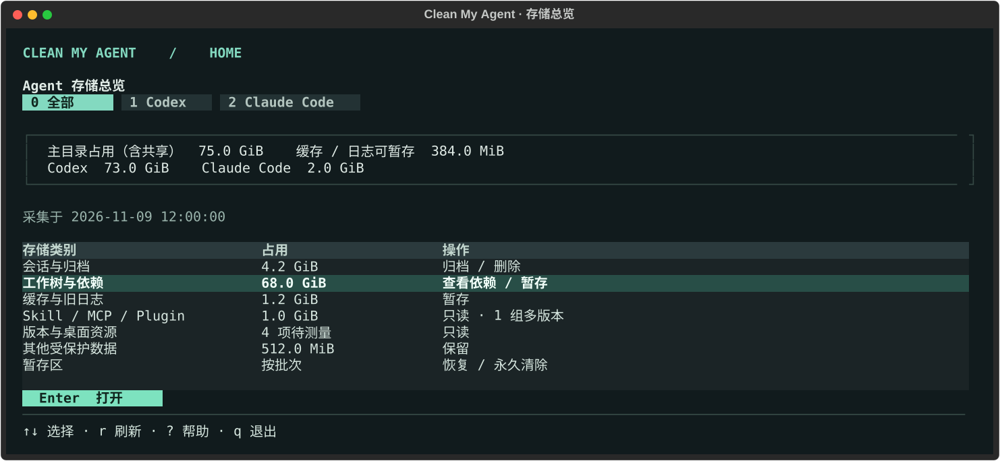

**图 1 · 先看占用，再进入操作。** 上方按 Codex / Claude / T3 显示主目录计块，下方显示会话、工作树、缓存日志等分类。主目录含共享块，不是实际可释放量；工作树行包含源码和依赖，进入后才核查依赖共享及运行状态。外部资源、暂存区单独查看，不与主目录重复相加。

| 在总览中做什么 | 操作 |
| --- | --- |
| 查看全部、Codex、Claude、T3 | `0`、`1`、`2`、`3`；指定 `--agent` 时保持该范围 |
| 查看某类明细与处理方法 | `↑ / ↓` 选行，`Enter` 进入 |
| 会话归档或删除 | 进入「会话与归档」，`a / d` 切操作，空格勾选，`x` 核对清单 |
| 暂存可重装依赖 | 进入「工作树与依赖」，选工作树按 `p`，空格勾选产物，`t` 核对 |
| 删除整个工作树 | 工作树列表按 `d`；检查通过后输入 `DELETE` 并确认，通过 Git 删除 |
| 暂存缓存和旧日志 | 进入「缓存与旧日志」，空格勾选，`t` 核对；`Ctrl+A` 全选 |
| 恢复或真正释放空间 | 进入「暂存区」，空格勾选条目，`r` 恢复或 `d` 永久清除 |
| Agent 缓存、旧版本和残留 | 进入「版本与桌面资源」，候选按 `t` 核对并暂存 |
| Skill / MCP / Plugin 及其他受保护数据 | 只读复核 |
| 刷新、查看说明和策略 | 首页 `r` 刷新，`?` 查看所选类别说明、范围与保留天数 |
| 返回首页或退出 | 子页面 `q` 返回；首页 `q` 退出；弹窗 `Esc` 返回列表 |

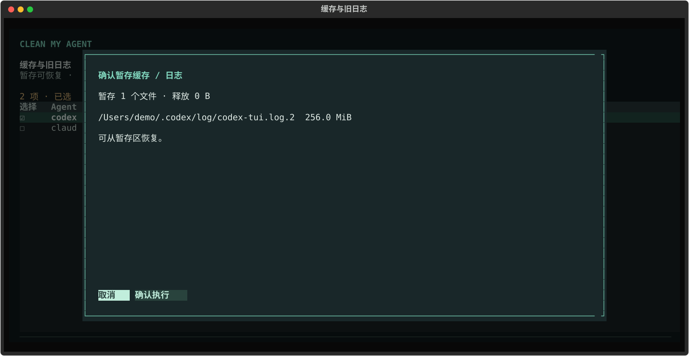

**图 1a · 所有操作先看清单。** 缓存 / 日志可以逐项勾选，确认后移入暂存区。暂存释放 **0 B**。回到首页进入暂存区，勾选条目后可恢复，或输入 `DELETE` 并确认永久清除。会话删除也需输入 `DELETE`，由 Codex 原生命令执行。归档只是整理，不保证释放空间。

操作后返回首页会重新统计；仅浏览后返回则复用采集结果，可按 `r` 刷新。运行 `clean-my-agent --quick` 会跳过大目录，面板明确提示未展开的目录数量。

界面使用本地组件，无需联网。`clean-my-agent --plain` 使用文本报告；未安装 UI、重定向、管道和 `TERM=dumb` 自动退回只读文本，不等待按键。`dashboard --json` 输出主目录总览；`scan --json` 保留包含依赖共享测量的完整报告结构。原有各单项命令仍可直接使用。

发布包安装器已注册用户 `PATH`；如果提示找不到命令，重新打开终端。源码开发者也可在虚拟环境中运行 `python -m clean_my_agent`。

完整工作树操作与删除条件见[工作树手册](worktrees.md)。整树删除独立于产物暂存，不进入暂存区，也不删除 Git 分支或会话记录。

## 在终端里浏览依赖

从总览进入「工作树与依赖」，或直接运行 `clean-my-agent deps`。支持 34 类产物与声明缓存，按 `w` 打开工作树列表，`Enter` 看详情、`p` 进入产物、`d` 核对原生删除；没有可清理产物的仓库也会列出。目录大小、共享占用和**单独删除预计释放**并排显示；候选按预计释放从多到少排序，范围按下限排序。长路径和引用来源在详情中展开，同一目标的软链接合并显示。

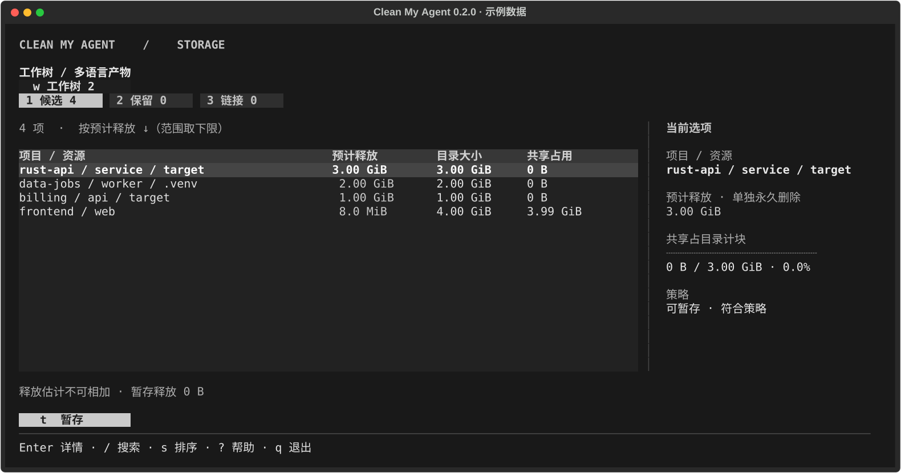

Agent 的桌面缓存、旧版本和安装残留使用 `clean-my-agent resources` 进入相同表格。列表标明所属 Agent，`Enter` 查看保留原因，候选 `t` 核对并暂存。具体范围见 [Mole 对照表](mole-reference.md)。

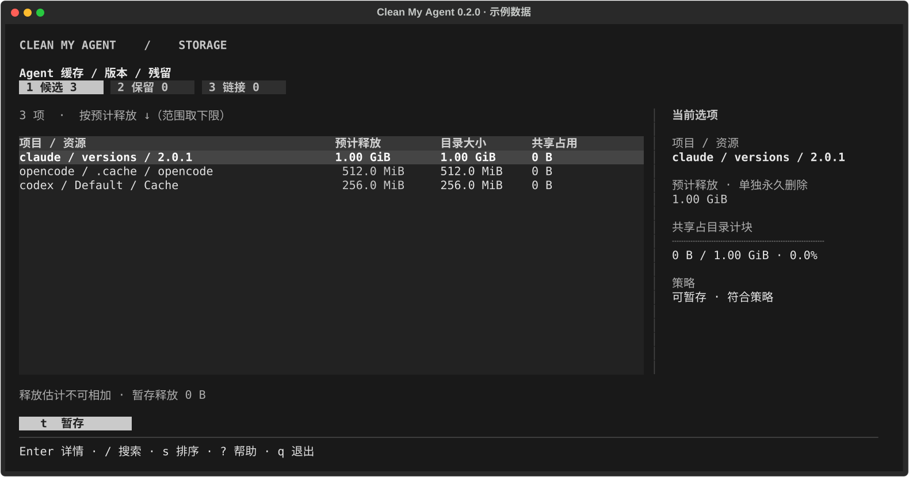

扫描期间，终端会在同一行显示耗时和当前阶段。统计顶层目录、测量依赖目录、复核工作树引用时，各自显示「已处理 / 总数」和进度条。比如「测量依赖目录 3/12」表示已处理 3 个目录；正在测量的大目录还会显示已读取的文件和目录项数。百分比按当前阶段的目录个数计算，不代表剩余时间。查找目录等总数未知的阶段只显示活动指示。进度只写到交互终端；`--json`、`--plain` 和管道不会混入进度，读取历史快照也不需要等待扫描。

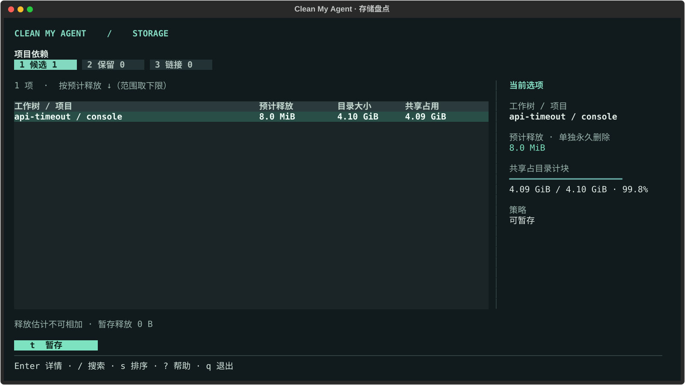

**图 2 · 从目录大小读到可释放量。** 图中选中的 `api-timeout / console` 目录计块 4.10 GiB，共享 4.09 GiB，单独永久清除预计只释放 8.0 MiB。优先看「预计释放」列。要核对来源，按 `2` 看保留项或 `3` 看链接，再按 `Enter` 看完整路径与引用。浏览、切组和查看详情不会执行操作；选择候选后按 `t` 才进入暂存确认。

| 操作 | 按键 |
| --- | --- |
| 切换候选、保留、链接 | `1`、`2`、`3`，也可点击页签 |
| 选中一行，查看完整路径、字节数和引用来源 | `↑` / `↓`，然后 `Enter` |
| 搜索项目、工作树或引用路径 | `/` 输入文字，`Enter` 浏览结果，`Esc` 清除 |
| 在预计释放量和目录大小之间切换排序 | `s` |
| 返回总览，查看其他存储类别 | 从总览进入时，按 `q` 返回 |
| 将所选路径打印回 shell | 在详情中按 `p` |
| 勾选候选依赖 | `Space` 勾选，`Ctrl+A` 全选 |
| 暂存所选候选依赖 | `t` 列出清单，`Enter` 确认，`Esc` 取消 |
| 暂存区 | `v` 打开，空格勾选条目，`d` 删除或 `r` 恢复 |
| 返回、帮助、退出 | `Esc`、`?`、`q` |

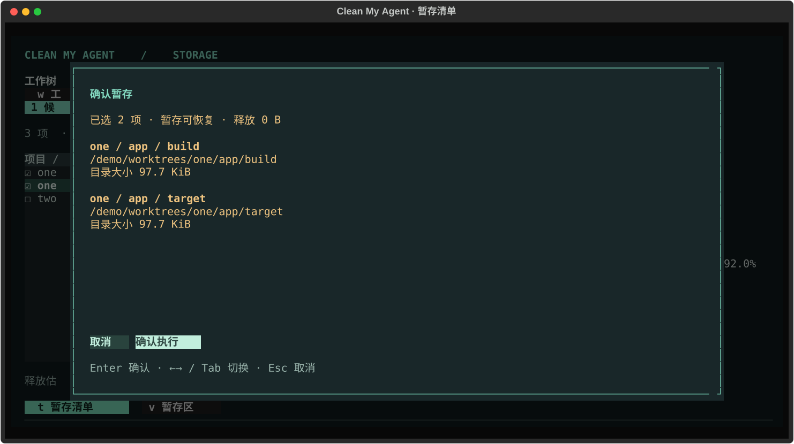

**图 2a · 键盘暂存。** 空格勾选产物，按 `t` 列出待暂存路径；按 `Enter` 确认，`Esc` 取消，`← / →` 或 `Tab` 切换按钮。容量与检查细节放在列表的 `Enter` 详情页。暂存后按 `Enter` 返回，再按 `v` 直接打开暂存区。

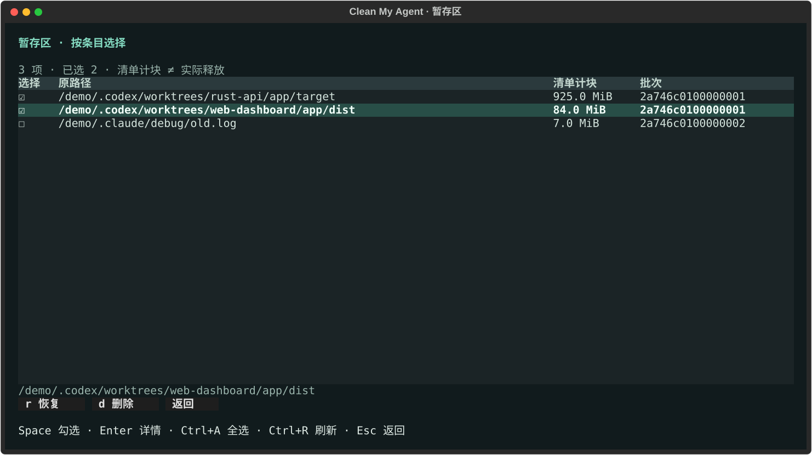

**图 2b · 只删除勾选条目。** 暂存区按空格勾选，`d` 展示永久删除清单，输入大写 `DELETE` 后按 `Enter` 执行；`r` 恢复所选条目。同一批次中未勾选的内容保留。操作完成后列表刷新；取消确认保留勾选。`Ctrl+R` 重新读取暂存区。

被引用、未测量、受保护的依赖不会开放暂存入口。执行前重新核对策略、目录身份和工作树引用。历史快照 `--from-report` 和显式 `deps --dry-run` 保持只读。

安装后有修改、项目仍在运行或检查不完整的目录也会保留；完整详情包含安装和运行检查。命令行、面板和 MCP 暂存前均重新验证。运行检查需要 `lsof`，缺失或超时不会当作“未运行”。详见[新增检查说明](resources-and-versions.md#deps-的新增检查)。

对耗时较长的盘点，可以保存一次，反复查看：

```sh
clean-my-agent deps --json > deps-report.json
clean-my-agent deps --from-report deps-report.json
```

`--from-report` 也接受含依赖明细的 `scan --json`。它展示采集时的状态，不扫描本机，也不能与 `--apply` 合用。要直接打印紧凑表格，用 `deps --table`；要保留所有路径，用 `deps --plain`。管道、非交互终端、JSON 输出和对指定目录的操作都不会等待按键。

发布包已内置 [Textual DataTable](https://github.com/Textualize/textual) 和 [Rich](https://github.com/Textualize/rich)，运行时不下载组件。源码基础安装缺少 UI 时，终端会显示紧凑表格。

## 会话报告：分别查看 Codex 和 Claude Code

```sh
clean-my-agent inventory
clean-my-agent inventory --agent claude --archive-days 5 --delete-days 15
clean-my-agent inventory --html sessions.html
clean-my-agent inventory --agent codex --full --details --limit 20
```

**直接在 shell 里查看交互报告：**

```sh
clean-my-agent reporter
clean-my-agent reporter --agent claude --archive-days 5 --delete-days 15
```

安装 `.[ui]` 后，`reporter`、`report` 和 `inventory --tui` 与 `deps` 共用 Textual 表格、右侧详情和确认弹窗。宽终端直接显示完整会话 ID，窄终端可按 `Enter` 展开。按 `i` 查看原来的活跃天数饼图及文件明细。截图使用虚构数据，不包含真实用户会话。

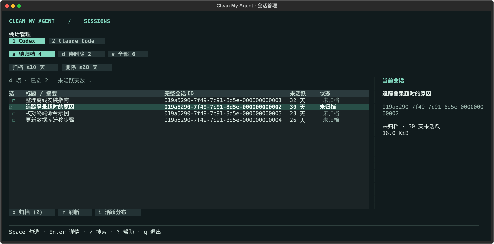

**图 3 · 勾选会话。** 按 `1` 切换 Codex，按 `a` 看待归档候选，或按 `d` 看待删除候选。用 `↑` / `↓` 选中行、空格勾选，按 `x` 查看操作清单。待删除只包含已归档且达到删除阈值的会话。Claude Code 继续只供人工复核，不开放执行。

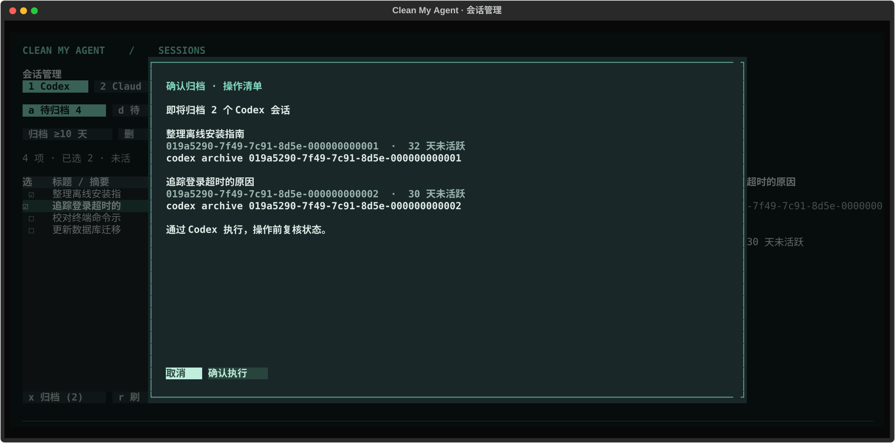

**图 3a · 核对再执行。** 清单列出每个选中会话的完整 ID、标题、未活跃天数和原生命令。默认焦点在「确认执行」，按 `Enter` 或点击按钮才逐项调用 `codex archive UUID`。取消不执行命令。

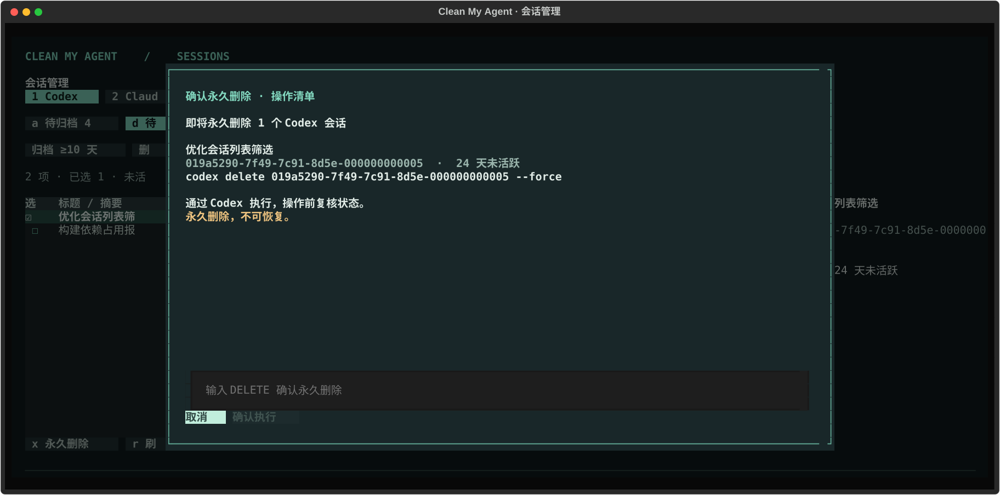

**图 3b · 永久删除。** 输入大写 `DELETE` 后，再按 `Enter` 或点击「确认执行」。工具使用 `codex delete UUID --force`；`--force` 仅用于在已经完成界面确认后避免第二个终端询问，不会改变其他权限。原生删除无法通过本工具的 `restore` 恢复。

| 按键 | 操作 |
| --- | --- |
| `1` / `2` | 切换 Codex / Claude Code |
| `a` / `d` / `v` | 待归档 / 待删除 / 全部会话 |
| 点击天数按钮 | 循环选择 5、10、15、20 天，按 agent 独立设置 |
| `↑` / `↓`、`PgUp` / `PgDn` | 选中行、翻页 |
| 空格 | 勾选或取消当前候选 |
| `Ctrl+A` | 勾选或取消当前筛选结果中的所有候选，包含需要滚动查看的行 |
| `x` | 查看完整操作清单并确认 |
| `Enter` | 完整标题、ID、状态与保留原因 |
| `/` / `Esc` | 搜索标题或 ID / 清除筛选和勾选 |
| `r` | 重新盘点 |
| `i` | 饼图和文件明细 |
| `?`、`q` | 帮助、退出；弹窗内返回列表 |

切换 agent、分类、天数或搜索条件时会清空勾选。表格展示所有匹配会话；`--limit` 只限制文本/导出报告及文件明细的展示条数。修改天数只影响本次视图，退出即丢弃。

每一项执行前重新检查活动时间、归档状态、置顶与保护规则；会话变化会跳过。命令返回后再次盘点核对结果。结果页区分已完成、已跳过、失败和待核对；失败或超时后不继续处理后续项、不自动重试，退出时仍打印已知结果。若刷新失败，按 `r` 再核对，不把旧列表当作实时状态。必须能在 PATH 中找到支持 `archive` / `delete --force` 的 Codex CLI；不支持时会提示，不改为直接删除会话文件。

普通 `inventory` 仍打印后退出。HTML、`--plain`、`--json` 和管道保持只读、不等待按键。未安装 Textual 时回退到原有只读 curses 图表；连 curses 也不可用时打印文本，不能在这些回退界面执行。

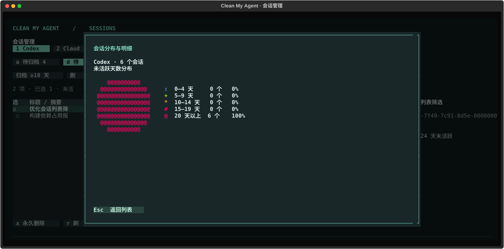

终端图表按 **不足 5 天、5–9 天、10–14 天、15–19 天、≥20 天**统计去重会话。HTML 是离线交互快照，可以切换 agent 和两项阈值，立即比较候选数与名单；不会执行命令、修改配置或随时间自动刷新。和终端、JSON 一样，HTML 复核清单含会话 ID、已有的标题或摘要；不会用聊天正文或第一条提示词补标题。缺少可用元数据时显示「无标题或摘要」（JSON 为 `null`）。导出到新文件（仅当前用户可读写），已有同名文件不会被覆盖。

字符饼图使用 [ascii.rest 的扇区绘图](https://ascii.rest/docs/kit-draw/#circles-and-shapes)：预先生成字符格中的圆形扇区，查看时按真实数据填充。用户无需安装 Node.js，报告不会向外发送会话信息。维护者可在 `dev/pie` 运行 `npm ci && node generate.mjs` 重建图形。

两种建议各自都支持 **5、10、15 或 20 天及以上**，按完整的 24 小时计，含阈值当天。默认满 **10 天复核归档、20 天复核删除**。仅改变本次报告用 `inventory` 的两个天数参数；要为某个 agent **保存默认值**，使用：

```sh
clean-my-agent policy --set-session-defaults --agent codex --archive-days 5 --delete-days 20
clean-my-agent policy --agent codex
```

同样可在 `policy.json` 的 `sessions.codex`、`sessions.claude` 中分别设置 `archive_days` 和 `delete_days`。未指定项保持不变。这些参数只影响盘点建议，不改变缓存清理、不定时或批量操作会话。设置了个人保护路径的会话不进入建议；某个 agent 盘点不完整时会提示错误，并暂停该 agent 的建议。

- **Codex：** 从本地 rollout 文件名提取 UUID，按 ID 去重。标题参考本地线程索引和 `session_index.jsonl`。可用时只读查询状态索引中的时间、归档和置顶标记，取文件修改、索引更新/活动、归档时间中的最新值。未归档只建议归档，已归档才建议删除；置顶、冲突或索引中找不到的记录不建议。没有索引时按文件位置和修改时间估算，不判断进程是否运行。数据库中没有对应本地转录文件的会话不计入。可在 reporter 勾选候选、确认后委托 Codex 原生命令执行；也可自行使用 `codex archive <SESSION_ID>` 或 `codex delete <SESSION_ID>`（永久删除）。
- **Claude Code：** 只将 `projects/<项目>/<UUID>.jsonl` 识别为主会话。按自定义标题、自动标题、摘要的顺序选取标签，查找范围为项目索引和主会话文件首尾各 32 KiB 的标题记录。其关联子代理和工具产物的修改可推迟建议；它们不另算会话，也不计入主会话文件容量。普通本地会话没有本工具可验证的归档状态，两项阈值均仅提示人工复核；同时命中时只列入删除复核。用 `claude --resume <SESSION_ID>` 在 Claude 中核对。本工具不调用 `claude rm`、不整项目清除，也不变更 Claude 的保留设置。
- **工作树：** Codex `$CODEX_HOME/worktrees/` 的一级目录仅盘点，`--full` 额外测量占用。在 Codex 桌面端归档关联聊天、在 Worktrees 设置中管理回收，详见 [Codex 工作树管理](https://developers.openai.com/codex/app/worktrees/#worktree-cleanup)。单独回收可重装依赖仍用 `deps`。

`--details` 展开文件和工作树清单，`--limit` 控制每组及每种建议的显示上限，**不影响图表或候选总数**。`--json` 的 `agents` 按 agent 提供报告；包含 Codex 时也保留旧版顶层 `groups` 字段。

## 如何选择清理策略

日常使用默认的 `standard`。正在排查问题、需要多留诊断记录时，选 `conservative`；磁盘紧张、可以更早重建缓存时，先预览 `deep`。下面是**本工具**的内置保留天数；到期只表示可以列入候选，不会触发自动删除。

| 档位 | 缓存 | 日志 | 项目依赖 |
| --- | ---: | ---: | ---: |
| conservative（保守） | 60 | 90 | 30 |
| standard（日常，默认） | 30 | 30 | 7 |
| deep（磁盘紧张） | 7 | 14 | 7 |

```sh
clean-my-agent policy                         # 当前真正生效的规则、保护路径、配置位置
clean-my-agent clean --profile deep --dry-run --details
clean-my-agent deps --profile conservative    # 查看可暂存的依赖，以及保留其他目录的原因
```

三个档位都只处理已识别的缓存、旧日志，以及通过独立命令选中的可重装依赖。常规清理保留会话（含归档）、历史工具输出、终端快照、工作树本体、数据库、登录凭据和未知文件。reporter 的会话操作单独经确认后调用 Codex 原生命令。体积大本身不是清理理由。报告按原因汇总已检查但保留的文件，JSON 输出中的 `policy`、`kept` 可用于查看实际阈值及保留原因。

**保存个人策略：** 编辑 `~/.config/clean-my-agent/policy.json`（若设置了 `XDG_CONFIG_HOME`，以 `policy` 显示的位置为准）。无需创建配置也可直接使用。运行 `clean-my-agent policy --example` 打印以下可编辑的示例：

```json
{
  "profile": "standard",
  "retention_days": {"logs": 60},
  "protect": ["codex:worktrees/keep-project", "claude:projects/keep-project"]
}
```

- `protect` 是从 `codex:`、`claude:` 或 `claude-cli:` 数据根开始的文件或目录路径。请将示例换成实际路径。保护目录包含所有后代，不支持通配符；例如 `claude:.` 保护整个 Claude 配置目录（外部 MCP 日志属于 `claude-cli:`）。为避免漏保护，比较时忽略大小写。依赖树内任意路径受保护，就保留整棵树。
- 保留期的优先级：本次 `--days N` > 配置文件的 `retention_days` > 所选档位。命令行 `--profile` 只切换基础档位。生效的分类键是 `cache`、`logs`、`dependencies`；天数均为正整数。`--days` 不影响独立的 `deps` 命令，也不能绕过保护。
- 暂存后新增的保护规则也适用于 `purge`：命中项会留在该批次，并可还原。已有配置不可读或无效时，工具停止清理；仍可用 `trash` 和 `restore` 查看、取回数据。

策略设计参考了 [Mole 的预览和保护名单](https://github.com/tw93/Mole#safety) 及其[对近期项目产物的处理](https://github.com/tw93/Mole#purge)。本工具保留自己的“先暂存，再核对清单永久清除”流程，不需要安装 Mole。2026-11-09 对其 Agent 清理源码的核对、当前扫描缺口及后续建议，见 [Mole Agent 清理对照](mole-reference.md)；其中规划中的路径尚未纳入本工具的清理范围。

## 清理旧文件

例如，先预览至少 **60 天未修改**的 Claude Code 文件，确认后用相同参数加上 `--apply`：

```sh
clean-my-agent clean --agent claude --days 60 --details
clean-my-agent clean --agent claude --days 60 --apply
```

第二条会重新扫描，把符合条件的文件移入暂存区，并打印批次编号。**暂存不会释放磁盘空间**。运行 `trash` 查看各批次的时间和大小。下面的 `BATCH` 替换为实际编号：

```sh
clean-my-agent trash BATCH          # 查看这批文件原来在哪里
clean-my-agent restore BATCH        # 想撤销时：放回原处，不覆盖同名文件
```

如果确认不再需要该批次，执行：

```sh
clean-my-agent purge BATCH          # 仅预览
clean-my-agent purge BATCH --apply  # 永久清除该批次，不可恢复
```

## 找出占空间的项目依赖

要查看目录大小、共享块和单独删除某个依赖目录的效果，可以使用以下命令：

```sh
clean-my-agent --agent codex              # 总览 → 工作树与依赖
clean-my-agent deps                       # 多语言产物，含保留原因和引用来源
clean-my-agent deps --json                # 精确字节；无法精确给出的值为 null
```

| 报告列 | 如何理解 |
| --- | --- |
| 目录 | 按已分配磁盘块统计；同一目录内的硬链接只计一次，稀疏文件不按逻辑长度算。不会跟随软链接。完整扫描总览已包含这些目录，不要再加一次。 |
| 共享 | 该目录引用的非独占块，含克隆、快照及目录外硬链接；不是所有项目去重后的物理总量。若文件系统只支持部分计量，会标出已确认的部分。 |
| 预计释放 | 假设在盘点时**单独永久删除**整个目录，能回收的文件数据块。用 macOS `getattrlistat` 的私有分配量与完整克隆引用数逐项测量；若目录内包含最后几份克隆、部分共享块或不支持这些属性的文件系统，则给保守范围。未能遍历完整目录时为未知。暂存本身释放 **0 B**。 |
| 保留 / 符合策略 | 与容量分开判断。保留行的预计释放值仅用于理解占用，不是清理许可。 |

交互总览默认统计完整主目录，进入产物页后才逐项测量。`deps`、`scan --json`、`scan --table` 默认包含完整测量；`scan --quick --json` 跳过空间测量。报告覆盖 Codex / Claude / T3 受管区域的仓库和子项目，并检查 Git 登记的其他工作树（含主工作区）的软链接；任意名称的链接指向产物或其内部时也会保护目标。支持相对链接、链接链和指向原位置的失效链接；不遍历已安装依赖或 `.git`。不声称检测所有未登记目录或自定义路径。外部目标只标注引用，不进入清理候选。暂存前重新检查，永久清除前发现新增引用也会保留。

报告为遍历期间的观测，不是文件系统快照。不汇总各行的释放估计：同一组共享块可能只有删除最后一个使用者时才释放。系统元数据、已打开文件、快照及后台写入也会影响磁盘空闲空间的实际变化。结构化字段为 `directory_bytes`、`shared_bytes`、`known_shared_bytes`、`unknown_bytes`、`reclaimable_bytes` 及其上下界 `reclaimable_min_bytes/max_bytes`；`referenced_by` 列出引用来源。`scan --json` 的产物报告在 `project_artifacts` 下，保留 `node_modules` 别名兼容旧客户端；`projects` 列出工作树完整占用；快速模式标记为 `references_only`。

候选必须是仓库或子项目下已识别、被 Git 忽略且不包含已跟踪文件的真实产物目录；有匹配且被跟踪的项目清单。Node 依赖还要求锁文件和安装记录。具体语言条件见 [规则表](mole-reference.md)。运行检查需要 Git、lsof、ps；无法确认时保留。

在浏览器按 `1` 选候选、`Enter` 打开详情，回到列表后按 `t` 核对并暂存。也可复制一个不再使用的产物路径，先预览再执行；Python `.venv`、Rust `target` 等使用相同命令：

```sh
clean-my-agent deps "/实际项目路径/node_modules"
clean-my-agent deps "/实际项目路径/node_modules" --apply
```

这一步整体暂存依赖，不动源码和锁文件。它检查目录及内部条目的修改时间，不跟随符号链接；任一条目在保留期内、命中保护路径、发现嵌套 Git 仓库或无法核实，就不暂存。修改时间不能证明项目已停用，请自行确认服务已停止。需要时可以按批次恢复；永久清除后，需要用对应的包管理器重新安装，本地手改的依赖不会随重装回来。多个项目可能共享硬链接或磁盘块，各自显示的大小不一定能相加得到最终释放量。

暂存后命令会输出一个批次编号。假设它是 `BATCH`（执行时换成实际编号）：

| 目的 | 操作 |
| --- | --- |
| 忘了批次编号、核对原路径 | `clean-my-agent trash`，然后 `clean-my-agent trash BATCH` |
| 项目还要用，撤销暂存 | `clean-my-agent restore BATCH` |
| 准备释放磁盘，先核对将被永久清除的内容 | `clean-my-agent purge BATCH` |
| 已确认不再需要，永久清除该批次 | `clean-my-agent purge BATCH --apply` |

还原和永久清除是两个选择。同一目录还原后，不需要再执行清除。**没有压缩命令**；同卷暂存保留恢复能力，不会腾出空间。单独打包共享依赖还可能额外占用空间。

## 哪些内容会被选中

| 内容 | 行为 |
| --- | --- |
| 已识别的 Codex 缓存和 CLI 旧日志；Claude Code 已知缓存、调试和 MCP 旧日志 | `clean` 按保留期筛选，标准档为 30 天 |
| 可重新安装的项目依赖 | 仅 `deps`，按目录明确选择 |
| 会话文件（包括归档） | 不进入本工具暂存区；reporter 确认后通过 Codex 原生命令归档/删除，Claude 只复核 |
| 历史工具输出、终端快照及未知文件 | 只盘点，不能暂存或永久清除 |
| 工作树本体 | 独立确认入口；仅通过检查的附加工作树可由 Git 原生删除 |

**从旧版升级：** `--include-history` 已移除，继续传入会报错并停止；配置中旧的 `snapshots`、`archives`、`tool-results` 天数不再生效。旧批次中的这些项目可用 `restore BATCH` 还原，`purge` 会跳过它们并返回非零退出码。混合批次中仍符合现行范围的文件可被清除，其余项留在原批次。

`scan` 和 `clean` 支持 `--agent codex|claude|all`、`--days N`、`--details`、`--profile` 和 `--json`。`clean`、`deps`、`purge` 均可显式使用 `--dry-run`，它与 `--apply` 互斥。JSON 中容量以字节表示。`scan --full` 只扩大统计范围，不扩大清理范围。快速扫描未展开的目录不计入其合计；完整扫描仅针对下列数据根目录，并不搜索整块磁盘。文件大小按占用的磁盘块估算。

## 路径与恢复

- Codex：`$CODEX_HOME`，默认 `~/.codex`。
- Claude Code：`$CLAUDE_CONFIG_DIR`，默认 `~/.claude`。另外扫描 macOS 的 `~/Library/Caches/claude-cli-nodejs` 或 Linux 的 `${XDG_CACHE_HOME:-~/.cache}/claude-cli-nodejs`。
- 暂存区：`${XDG_STATE_HOME:-~/.local/state}/clean-my-agent`，每个批次都记录原始路径。恢复时请使用与暂存时相同的环境变量。
- 常规扫描跳过符号链接，清理跳过有多个硬链接的文件。操作前会复核文件身份、大小和修改时间。暂存只做同卷移动；如果数据目录在其他磁盘，可以把 `XDG_STATE_HOME` 设到同一磁盘的独立目录。
- 原路径已被占用时，该项留在暂存区。若老日志被尚未关闭的进程继续写入，永久清除会拒绝修改过的文件，但仍可还原。遇到权限问题或部分失败时，终端会报告原因并返回非零退出码，可用 `trash BATCH` 查看剩余项目。

运行 `python3 -m unittest discover -s tests -v` 可在临时目录中验证扫描、暂存、还原和永久清除。测试不会操作当前用户的真实会话。

## 常见问题

| 现象 | 下一步 |
| --- | --- |
| 明明有几十 GiB，只看到一小部分 | 默认总览已统计完整主目录。若用了 `--quick`，去掉后重开；若仍不完整，按 `?` 查看扫描范围和错误。 |
| 进度暂时停在同一个百分比 | 百分比按当前阶段完成的目录数计算。大目录内的读取项数和耗时仍会更新；下一阶段从自己的 0 开始。 |
| 只有表格或没有进度 | JSON、纯文本、管道不会显示动画。全屏依赖浏览器需要交互终端和 UI 可选包；安装方式见[首页](../README.md)。 |
| 共享或释放显示未知 | 文件系统或权限未提供足够信息。看上下界和错误，不把未知当成 0 或整个目录大小。 |
| 暂存按钮不可用 | 只对实时、完整报告中的候选开放。快照、`--dry-run`、被引用或受保护的目录保持只读。 |
| 想让 AI 做相同的盘点 | 按[Agent 接入指南](agent-setup.md)安装，再让它调用 `get_policy` 和 `scan_usage`。 |
