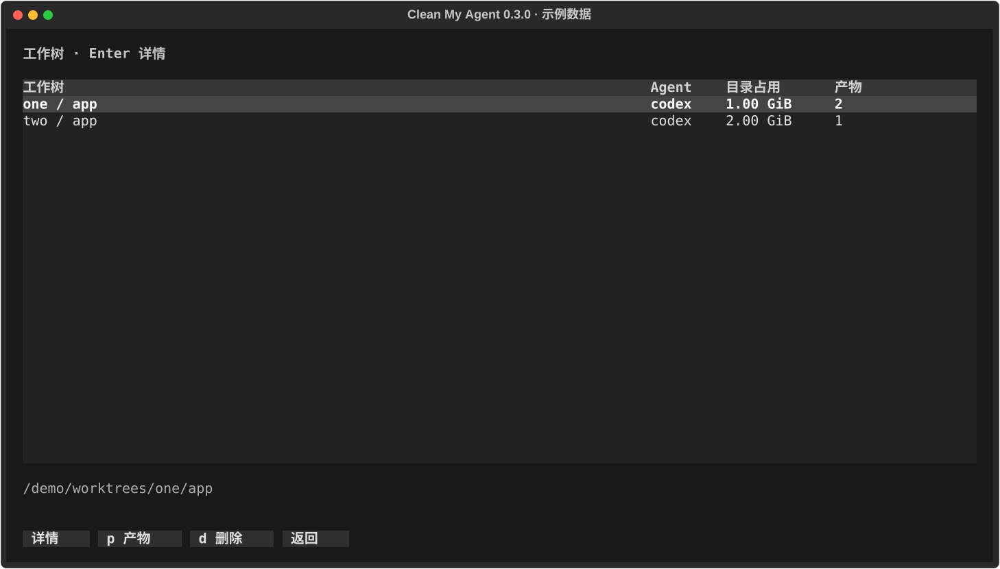
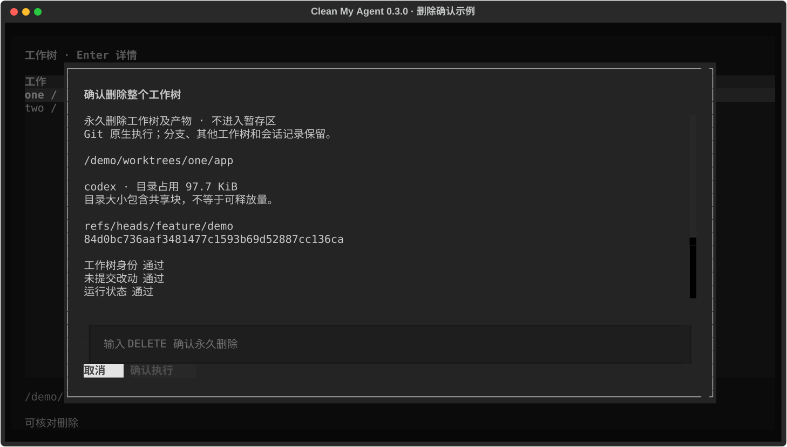

# 工作树：查看、清理产物与原生删除

[返回首页](../README.md) · [完整手册](user-guide.md)

0.3.0 起，从总览进入「工作树与依赖」会先打开可选择的工作树列表；直接运行 `clean-my-agent deps` 后按 `w` 也可进入。Windows、历史快照和 `--dry-run` 保持只读。

## 操作路径

| 操作 | 按键 |
| --- | --- |
| 选择工作树 | `↑ / ↓` |
| 查看详情和实时检查结果 | `Enter` |
| 进入这个工作树的产物清单 | `p` |
| 勾选产物 | `Space`；`Ctrl+A` 勾选当前列表的候选 |
| 核对并暂存所选产物 | `t` 列出完整路径，`Enter` 确认，`Esc` 取消 |
| 打开暂存区 | 产物页按 `v`；空格勾选，`d` 删除 / `r` 恢复 |
| 返回工作树列表 | 产物页按 `w` |
| 删除整个工作树 | 工作树列表按 `d`，检查通过后输入 `DELETE` 并按 `Enter` 确认 |
| 返回上一层 | `Esc` / `q`；详情弹窗先返回列表 |

切换工作树、筛选或候选类别会清除勾选；界面不会把不可见的旧选择混入操作。多选产物先重新核查全部选择，再进入原有暂存流程；发生部分成功会显示错误和批次号。暂存释放 0 B，要真正释放空间可直接按 `v` 进入暂存区，空格勾选条目、按 `d`，输入 `DELETE` 并按 `Enter` 确认永久删除。同批次未勾选的条目保留。

## 删除整个工作树

使用 Git 原生命令 `git worktree remove -- <绝对路径>`，不加 `--force`，不使用通用目录删除，也不修改 Codex 的内部工作树或会话索引。[Git 官方说明](https://git-scm.com/docs/git-worktree#Documentation/git-worktree.txt-remove)

只接受 Agent 项目范围内、Git 已登记的附加工作树。主工作区和独立 clone 保留。原生删除会移除该工作树目录及其登记；共享仓库、Git 分支、其他工作树和会话记录保留。**整树删除不进入暂存区，不能用 `restore` 恢复。** 如只需要清理依赖或缓存，请进入产物列表。

删除前的检查：

- 工作树路径和身份、Git 登记、锁定状态、保护路径；拒绝链接路径及未完成的 merge/rebase 等操作。
- 已跟踪文件的未提交改动，以及未跟踪文件。有改动就保留，不自动提交或丢弃。
- 被 Git 忽略的内容：只接受能够通过现有类型、安装证据和持久数据检查的产物；`.env`、未知忽略文件、源码仓库和子模块保留。产物链接只移除链接本身，不展开外部目标。
- 分离 HEAD 上的提交须被分支、远程跟踪分支或标签保留；不删除没有持久引用的提交所在工作树。
- 当前用户的进程、工作目录、打开文件及启动参数；检查失败或超时视为未知，保留。
- 受管仓库及其 Git 登记工作树的软链接引用，含指向工作树内部或祖先目录的链接。被引用时保留。
- 已知 Codex 工作区登记和会话索引：未归档或置顶会话仍引用时保留；已归档会话在详情中提示，其记录保留。
- 仍关联本工作树的暂存批次：先恢复或永久清除这些批次，避免删除恢复所需的原项目。

确认之后会再次读取所有检查结果，并比对工作树身份、HEAD、分支和文件元数据指纹。状态有变化则停止；原生 Git 拒绝删除时不强制重试。执行后同时核实目录和 Git 登记均已移除；超时或结果不明确时显示“未确认”，需要重新盘点。

检查是时点观测，文件指纹不是内容哈希，也不覆盖全盘任意程序的自定义引用。其他用户的进程、未登记项目、回填旧时间戳的内容修改以及最后检查后的并发写入不保证可检测。已归档会话重新打开时，原工作树路径可能已不存在。

该删除入口独立于常规 `clean` 和 MCP。MCP 继续只提供原有盘点、暂存与恢复工具，不开放整树永久删除；不会因日常扫描自动删除工作树。
